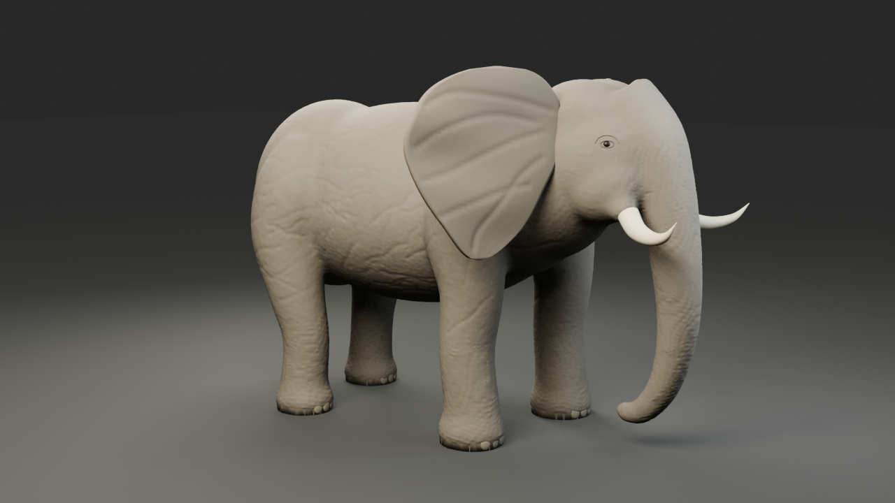

# KHOSAN TIME STUDIO

**Master repository for the KHOSAN AI-native Creative Intelligence & Game Studio**

KHOSAN TIME STUDIO is designed as a creative-intelligence and game-production environment where a human creator works with an AI Studio Orchestrator, a Creative Intelligence Council, specialized production agents, deterministic tools, a shared intermediate representation (UG-IR), verification gates, and export adapters.

> **Human = Executive Producer · Agents = specialists · Tools = production machines · UG-IR = common language · Studio = orchestrator**

## Current status

**Phase: FOUNDATION / MASTER REPOSITORY**

This repository is the source of truth for:
- studio architecture and product vision,
- multi-agent harness and role contracts,
- tool registry and integration decisions,
- KHOSAN Asset IR / UG-IR direction,
- game-creation workflow,
- local development with ChatGPT + DevSpace,
- verification and human approval gates,
- deployment/packaging documentation,
- research/knowledge index and roadmap.

The interactive Studio application itself is **not yet production-complete**. Deployment documents distinguish between what exists now and what must be implemented next.

## How a creator should use the Studio

The creator should not manually choose 13 agents.

```text
Explore / Create New Game
      ↓
Describe intent, emotion, culture, fantasy or problem space
      ↓
Creative Intelligence Council
      ↓
Concept Portfolio + Micro-prototypes
      ↓
Creative Constitution
      ↓
Human Concept Approval
      ↓
Design + Architecture
      ↓
Asset / Gameplay / Rendering / World production
      ↓
QA + Independent Review
      ↓
Playable Preview
      ↓
Natural-language change requests
      ↓
Build / Export / Deploy
```

Example:

> Create a 3D fantasy Isan RPG. The player is a spirit doctor exploring villages, fighting spirits, with day/night cycles. Browser/WebGPU first.

KHOSAN converts that intent into bounded work items, routes only the required specialists, executes production tools, validates outputs, and presents human approval gates.

## Repository map

| Path | Purpose |
|---|---|
| `AGENTS.md` | root harness rules and routing |
| `docs/` | product, architecture, workflow, deployment and roadmap |
| `studio/agents/` | specialized AI role contracts |
| `studio/contracts/` | work-item / handoff / evidence contracts |
| `studio/templates/` | reusable task and approval templates |
| `studio/graph.md` | explicit production graph and rollback routing |
| `studio/tool-registry.yaml` | canonical production-tool registry |
| `studio/studio_state.json` | durable Studio execution state |
| `knowledge/` | research/source registry |
| `scripts/` | bootstrap and verification helpers |
| `deploy/` | local/self-host deployment guidance |

## Multi-project workspace

KHOSAN Studio is installed once while each game is an independent workspace. The Studio keeps a Project Library, one active interactive project, portable project manifests and project-scoped work-item contracts. Tools/models may be shared, but project truth and writes remain isolated per game.

See [docs/22-MULTI-PROJECT-WORKSPACE-ARCHITECTURE.md](docs/22-MULTI-PROJECT-WORKSPACE-ARCHITECTURE.md).

## Creative Intelligence

KHOSAN treats “game generation” as only one subsystem. Before expensive production, the Studio can explore a concept space, critique derivative or incoherent ideas, build micro-prototypes, observe players and lock a **Creative Constitution**.

After release, a separate live loop combines community evidence and telemetry into experiment proposals without allowing the loudest community channel to rewrite the game's vision automatically.

The full roster is now **21 roles**:
- 13 production/governance roles (00–12),
- 8 Creative Intelligence advisory roles (13–20).

See:
- [docs/12-CREATIVE-INTELLIGENCE.md](docs/12-CREATIVE-INTELLIGENCE.md)
- [docs/13-CREATIVE-CONSTITUTION.md](docs/13-CREATIVE-CONSTITUTION.md)
- [docs/14-PROTOTYPE-ARENA.md](docs/14-PROTOTYPE-ARENA.md)
- [docs/15-COMMUNITY-INTELLIGENCE.md](docs/15-COMMUNITY-INTELLIGENCE.md)

## Core tools already adopted

### 2D production
**sprite-gen** — one still image to game-ready sprite atlases and transparent motion loops, including frame manifests, curation, deterministic post-processing and QA.

Source: https://github.com/kongsak4807017/sprite-gen

### 3D production
**img2threejs** — reference-image to procedural/structured 3D reconstruction. KHOSAN will adapt its output into Asset IR rather than making Three.js the Studio's core data model.

Source: https://github.com/kongsak4807017/img2threejs

### Local headless 3D MCP — runnable source

The repository also includes a local Blender/MCP pipeline for authored static 3D assets: amphora, table, column, rock, terrain and a reference-guided elephant. It creates editable BLEND, self-contained GLB, four actual preview views, measured geometry and hash-bound review evidence. Modeling runs locally without Oriverse or Trellis2.

[](docs/examples/local3d/elephant-r6/README.md)

Original reviewed r6 example, preserved with [four Blender views and existing-V4 evidence](docs/examples/local3d/elephant-r6/README.md). Fresh release builds produce their own artifacts and review records.

After installing Python 3.12 and Blender, run from this checkout, replacing the example Blender path with your executable:

```bash
python scripts/local3d.py setup --blender "/absolute/path/to/blender"
python scripts/local3d.py doctor
python scripts/local3d.py proof --fixture elephant --quality draft
python scripts/local3d.py config
```

Use `python3` where that selects your interpreter. Windows also has `SETUP_LOCAL3D.bat`. The generated `.khosan/local3d-mcp.json` contains this machine's MCP stdio configuration; do not copy the original owner's paths. Standalone modeling needs neither the Studio Web/API nor a private Harness V4 checkout.

The quick start selects **draft** previews for CPU/software-rendered machines: 640 × 360 at 8 samples, with the same model geometry. For final visual inspection, run `python scripts/local3d.py proof --fixture elephant --quality standard` to request the original 1280 × 720, 64-sample views. Standard remains the default when `--quality` is omitted. Draft and standard have separate job identities; an incomplete standard render is not a completed proof.

The optional locked Remotion/Three runtime adds a native static-GLB proof with genuine LTC area lights and a separately measured ground-shadow proxy. It does not supply rigging, animation or final art approval. The original elephant's accepted r6 images and measurements are historical examples; a new build has its own digest and review status.

- **[Portable install and reproduction guide — English / ภาษาไทย](docs/27-LOCAL3D-PORTABLE-INSTALL.md)**
- [Local architecture and original prop proof](docs/25-LOCAL-3D-MCP.md)
- [Elephant method, parameters and original r6 evidence](docs/26-LOCAL-3D-ELEPHANT.md)
- [Thai tool runbook](tools/local_3d_mcp/README_TH.md)

### Reference reconstruction
KHOSAN now defines a canonical **Reference Reconstruction Workflow** for reference-driven scenes, generic assets and UI: condition the reference, lock art direction, decompose, block out, compare, diagnose, repair only failing dimensions, normalize technically, verify independently and freeze only after human approval.

See [docs/21-REFERENCE-RECONSTRUCTION-WORKFLOW.md](docs/21-REFERENCE-RECONSTRUCTION-WORKFLOW.md).

### Harness engineering
**learn-harness-engineering** — basis for instructions, state, verification, scope, lifecycle, maker/checker separation, context isolation and graph engineering.

Source: https://github.com/kongsak4807017/learn-harness-engineering

## P0 tool acquisition / integration backlog

1. Physics — Rapier
2. Navigation — Recast + Detour
3. glTF processing — glTF Transform
4. Mesh optimization — meshoptimizer
5. GPU texture compression — Basis Universal / KTX2
6. PBR/material authoring — Material Maker
7. AI workflow backend — ComfyUI
8. 3D auto-rigging — evaluate UniRig + deterministic Blender fallback
9. Animation retargeting — select and validate a production tool
10. Visual node editor — Rete.js
11. Dialogue/quest runtime — Yarn Spinner
12. Browser audio runtime — Web Audio / Tone.js
13. AI audio/music generation — evaluate license-safe production option
14. Automated browser/game QA — Playwright
15. Large binary asset management — Git LFS

See [docs/03-TOOL-REGISTRY.md](docs/03-TOOL-REGISTRY.md).

## DevSpace connectivity profile

When ChatGPT needs to operate on the local workspace, KHOSAN supports an optional MCP connectivity layer:

~~~text
ChatGPT
  ↓ HTTPS tunnel
ngrok / Cloudflare
  ↓
DevSpace MCP 127.0.0.1:7676
  ↓
allowed local project roots
~~~

This is separate from the KHOSAN Studio Web/API on `127.0.0.1:8080`. The DevSpace tunnel must not publish the Studio port by default.

Safe configuration examples and a connectivity doctor are included; machine-specific domains, auth tokens, owner tokens, credentials, logs and tunnel binaries remain local-only.

See:
- [docs/18-DEVSPACE-CONNECTIVITY.md](docs/18-DEVSPACE-CONNECTIVITY.md)
- [docs/19-CHATGPT-DEVSPACE-PERSISTENT-WORKSPACE.md](docs/19-CHATGPT-DEVSPACE-PERSISTENT-WORKSPACE.md)

## Deployable Studio baseline — v0.2.0

The repository now contains a runnable local Studio Web/API baseline in addition to the architecture/harness.

Current runnable capabilities:
- Studio Home and Idea / Concept Lab,
- multi-project Project Library with one active project,
- active-project switcher and project workspace view,
- durable isolated project creation with `khosan-project.json` and `.khosan/` state,
- project-aware routing and workspace boundary API,
- Blueprint and Creative Constitution persistence,
- 21-role Agent Workboard overview,
- Tool Registry/provenance view,
- health/status API,
- SkinTokens/UniRig rigging adapter boundary,
- Docker/self-host package.

The local web server intentionally does **not** pretend to be the ChatGPT LLM. ChatGPT performs agent reasoning; DevSpace runs bounded local work/tools; the Studio Web/API persists project state and presents the creator-facing shell.

See:
- [docs/22-MULTI-PROJECT-WORKSPACE-ARCHITECTURE.md](docs/22-MULTI-PROJECT-WORKSPACE-ARCHITECTURE.md)
- [docs/23-DEPLOYABLE-STUDIO-V0.2.md](docs/23-DEPLOYABLE-STUDIO-V0.2.md)

## Start locally

### 1. Clone
```bash
git clone https://github.com/kongsak4807017/KHOSAN-TIME-STUDIO.git
cd KHOSAN-TIME-STUDIO
```

### 2. Bootstrap and run
Linux/macOS:
```bash
chmod +x scripts/*.sh
./scripts/bootstrap.sh
./scripts/run-studio.sh
```

Windows PowerShell:
```powershell
.\scripts\bootstrap.ps1
.\scripts\run-studio.ps1
```

Open `http://127.0.0.1:8080`.

Docker:
```bash
docker compose up --build
```

### 3. Open with ChatGPT + DevSpace

Use:

> Open this local workspace. Operate as KHOSAN Studio Orchestrator. Read AGENTS.md first, then studio/studio_state.json, studio/graph.md and the active work item. Do not implement until scope, allowed paths, acceptance criteria and verification are explicit.

See [docs/07-CHATGPT-DEVSPACE-WORKFLOW.md](docs/07-CHATGPT-DEVSPACE-WORKFLOW.md).

## Self-host / deployment

Start with [docs/06-LOCAL-DEPLOYMENT.md](docs/06-LOCAL-DEPLOYMENT.md) and [deploy/README.md](deploy/README.md).

Deployment is intentionally staged:
1. **Repository/harness mode** — available.
2. **Local Studio shell v0.2** — available: Web/API + Project Library + active-project isolation + durable project state.
3. **Docker Studio shell v0.2** — available for trusted-local self-hosting.
4. **Tool workers** — rigging adapter exists; full GPU/tool-service fleet remains staged.
5. **Playable runtime integration** — WebGPU/UG-IR live preview remains roadmap work.
6. **Remote/team deployment** — not approved until authentication/security hardening exists.

## Non-negotiable engineering rules

- No evidence → no Done.
- Maker cannot approve its own output.
- Preserve unrelated user changes.
- Do not silently widen task scope.
- Destructive git/filesystem actions require human approval.
- Push/merge/deploy/publish and paid external side effects require human approval.
- Engine/backend-specific assumptions must not leak into UG-IR core.
- Generated asset uncertainty must be recorded, not hidden.
- Use deterministic stages after generative stages wherever possible.

## License

A project license has not yet been selected. Do not assume third-party tool licenses transfer to KHOSAN. Every adopted dependency must be recorded with its own license and redistribution constraints.
