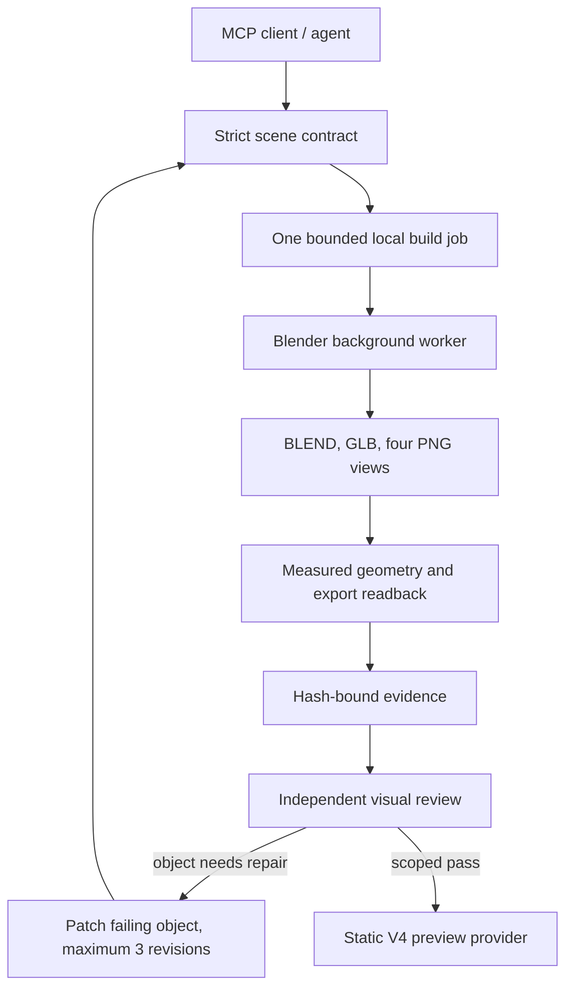

# Local headless 3D production adapter

Date: 11 November 2026 (Asia/Bangkok)

For a new checkout or another computer, use the [portable installation and reproduction guide](27-LOCAL3D-PORTABLE-INSTALL.md). The original v0.1 architecture and measurements below are retained as historical evidence; they do not approve outputs from a changed implementation.

## Decision and scope

KHOSAN can own the scene specification, local workers and evidence loop while using replaceable 3D backends. The first executable local slice uses Blender background mode and the official MCP Python SDK. It has no Oriverse runtime dependency.

The implementation is additive under `tools/local_3d_mcp`. Existing UG-IR direction, Character Factory, img2threejs source pipeline and episode source remain their own contracts. This is a static procedural asset/scene adapter, not a claim that the complete Oriverse engine or its language has been reproduced.

The source baseline was materialized on the owner's Windows PC from GitHub commit `38ae23cb08829e1867dfac05293e4f3e5683aff2`. All 155 source files matched their Git object hashes. It is a verified source snapshot; no `.git` directory, remote push or merge was created during installation.

## What the supplied documents actually establish

Sources reviewed:

- [AI 3D harness](https://docs.google.com/document/d/1Cm8CkZoRbtwB5U71IJY5B9R2_sI9zfR7dr77wv9SG5I/edit)
- [Syntax Weaver research](https://docs.google.com/document/d/1-BubH1Ealqlp1x3NRSxSvRsDDAJ05VMgHOQ3fn_9Rgc/edit)
- Attached `Pasted text(2).txt`
- [KHOSAN-TIME-STUDIO source](https://github.com/kongsak4807017/KHOSAN-TIME-STUDIO/tree/38ae23cb08829e1867dfac05293e4f3e5683aff2)
- Existing local Harness V4 source and installed dependency APIs

Useful architectural ideas include structured IR, object decomposition, reference locking, measured output checks and maker/checker separation. The supplied example code should not be labeled a production system:

1. The pasted HTML generator imports `oriverse-engine` from a CDN.
2. The visual critic example has a TODO for the vision call and approves even a nonexistent image path.
3. The compiler in the research document requires an indentation fix and the test fixture variable to be supplied before its seven narrow tests pass.
4. The sample Three transpiler ignores character/cloth/rig semantics, uses boxes for top-level object declarations and empty Groups for nested assets. It does not execute a render loop or advance animation.
5. Declared polygon budgets are not actual measured geometry, and millisecond IR compilation is not model/rig/render performance.
6. The hand-written HTTP wrapper does not implement either its claimed legacy HTTP+SSE transport or complete Streamable HTTP behavior.

The new implementation therefore uses an explicit supported subset, real Blender outputs, real image delivery, the official transport implementation and a review state that cannot silently become PASS.

## Architecture



### Scene contract

`khosan.scene/1.0` explicitly defines meters, right-handed Y-up coordinates, deterministic seed, named materials, stable object IDs, recipe parameters, camera, render budget and provenance. Unsupported fields, duplicate IDs, invalid references, nonfinite numbers and unknown recipes fail.

The `.weave` front end is a documented KHOSAN dialect, not an Oriverse interpreter. It compiles to the same JSON contract. Blender receives data, never client-supplied executable Python.

### Actual modeling

Five bounded recipe families are provided: amphora, table, column, rock and terrain. The authored demonstration includes hollow vessels with modeled handles, separate beveled table planks and joinery, a fluted column and a shaped ground stage. Semantic objects remain assemblies of editable parts.

The worker exports PBR-compatible base materials without external texture references. It reimports the actual GLB into a fresh Blender scene and compares measured counts, bounds, materials and semantic IDs. The demonstration contains no skeleton, animation or simulated physics.

### MCP and process ownership

The default transport is stdio using `mcp==1.29.0`, tested with the official SDK client. It opens no TCP port and does not reuse DevSpace's 7676/7678 listeners. The MCP client owns the server process. Long builds return a job ID immediately and are polled.

The configured root is supplied once at server startup; tool calls cannot change it. Jobs have unique directories, a timeout, normal cancellation and a per-root OS lock. Failed artifacts/logs are retained for diagnosis. Normal cancellation and timeout kill only the owned worker. Abrupt forced parent termination is not a Blender crash-resume mechanism; that remains a documented limitation.

### Evidence and critic

The build key includes normalized specification, original source, implementation, Blender version, references and repair lineage. Every output is hashed and checked before cache reuse. Review records bind to the exact artifact set. Missing review, changed images, corrupted job identity, inconsistent measured metadata or stale source refuse a valid status.

The separate critic uses the actual four views and records object-specific findings. There is no bundled local VLM or fake automatic visual PASS. The trusted client supplies reviewer identity; this is auditable attribution, not cryptographic identity authentication.

Object repair supports recipe parameters, transforms and material references only. It preserves passing objects in the specification and stops after three repair revisions. Scene-level camera/light findings require a deliberate new scene specification. Rebuilding a scene currently rebuilds its geometry; only unchanged complete jobs use the verified artifact cache.

Human acceptance remains separate and is never automatically granted.

### Harness V4 boundary

The existing V4 scene calls a provider through `{group, objects, update(absoluteSeconds), dispose}`. The new adapter implements that interface, checks the GLB bytes before parsing and preserves semantic object/part IDs. It uses absolute source time and rejects animation, skin/morph or physics capabilities it has not implemented.

The old V4 status checker proves its own EP43 18-second study. It is not modified or reused to approve this task. A separate composition and verifier under `adapter/v4/` use the installed V4 dependencies and produce native stills, actual browser metrics, a hidden-asset image control and repeat-frame evidence. Its PASS, if obtained, is scoped to this static scene integration; see the actual verification report for execution status.

## Installation and usage

For the current portable release, run these commands from this checkout's root after installing Blender. Replace the executable placeholder with the Blender path on this machine. See the [portable guide](27-LOCAL3D-PORTABLE-INSTALL.md) for OS-specific details and `tools/local_3d_mcp/README_TH.md` for the tool list and supported DSL.

```powershell
python scripts/local3d.py setup --blender "<path-to-installed-blender-executable>"
python scripts/local3d.py doctor
python scripts/local3d.py proof --fixture props
python scripts/local3d.py config
```

The Windows wrapper also supports `.\scripts\setup-local3d.ps1 -Async -BlenderPath "<path-to-installed-blender-executable>"` for a command connection with a short request deadline. Read `.khosan/local3d-setup/stdout.log` and `stderr.log` instead of starting overlapping installations.

`config` writes the current machine's absolute paths to `.khosan/local3d-mcp.json` as UTF-8. Add that generated server entry to the client; setup does not rewrite global client configuration. The committed `config/local3d-mcp.example.json` describes the shape rather than supplying another machine's paths.

The proof job writes `.khosan/local3d/proof.json`, containing the exact artifact directory and measured cold/warm timings. A warm cache hit is reuse of existing verified outputs, not a benchmark for producing a new asset.

## Verification and next capability boundaries

Authoritative execution evidence: `studio/evidence/TASK-LOCAL-3D-MCP-001.json` and the specific job's `manifest.json`, `measured.json`, `harness-asset.json` and optional `qa-v4` report.

### Observed target-PC results — 11 November 2026

The Windows proof ran through the real official MCP client, stdio server and Blender executable. Its immutable smoke record is `.khosan/local3d/proof.json`; that record describes the instant before the later independent image review and V4 verification. Consult the current job manifest and task evidence for the later review status.

| Check | Actual result |
|---|---|
| Target | Windows, Python 3.12.10, Node 24.20.0, Blender 5.2.2 LTS |
| SDK / negotiated protocol | MCP Python SDK 1.29.0 / 2025-11-25 |
| MCP tools / image delivery | 11 tools; actual image content received |
| Job | `job-f79716ca948546c4` |
| Cold new build | 11.578 seconds |
| Verified warm cache request | 0.031 seconds |
| Source scene | 9 semantic objects, 66 editable mesh parts, 39,304 triangles, 22 materials |
| Four Blender views | 960 × 540 PNGs; front, side, back and hero |
| GLB reimport | Counts, semantic IDs and materials match; maximum bounds difference 0.0 m |
| Python contract tests | Linux 28 pass; Windows 27 pass and 1 expected symlink-privilege skip |
| Three adapter tests | 16 pass using the real emitted GLB and Three 0.181.1 |
| V4 runtime | Existing Remotion 4.0.542 / Three 0.187.0 / installed Chrome |
| V4 still integration | `PASS_SCOPED_STATIC_GLB_STILLS`; frames 0 and 45, 960 × 540 |
| V4 repeat frame | Frame 45 repeated in the same browser instance produces identical PNG SHA-256 |
| V4 hidden control | 52,361 pixels differ when the asset is hidden; visible render has 80 render meshes |
| V4 source boundary | Fingerprinted existing V4 sources and dependencies unchanged |

The exact implementation digest is `be73aee29b30ee1f47664ed6dafb8e983022f74d5e90b6c86083d0dbec6dcaf3`. The artifact-set digest is `a1e16e6233d6e0f2fe95f8ede37fce82db930cf535fd23c22c630b36f2fd96cf`.

The separate V4 report is `.khosan/local3d/jobs/job-f79716ca948546c4/qa-v4/2026-11-11T16-39-28.201Z-717dae/verification.json`. Its renderer reports 160 draw calls and 78,608 rendered triangles across rendering passes; these are not 160 authored parts or 78,608 unique asset triangles. Multi-material nodes create 80 render meshes from 66 editable source parts.

Independent Reviewer returned **ACCEPT** for the scoped static v0.1 task after code review and direct inspection of all four Windows Blender views and the three V4 evidence images. The actual MCP review is `review-23e41bbb2d8c.json`; a subsequent official SDK status call confirms current integrity, technical, export and visual PASS. Human acceptance remains NOT_REVIEWED and production_ready remains false.

The V4 stills use their own camera and lighting, so they establish a functioning static-asset integration, not visual parity with Blender. No MP4, continuous-playback test, same-page seek test, complete episode or human art acceptance is implied. The current V4 stack emits a nonfatal Three.Clock deprecation warning; the recorded browser error list is empty.

These are observations from one authored fixture on this PC. A cache hit reuses already generated artifacts and is not a new-model generation benchmark. No comparative speed or universal quality claim against Oriverse was tested.

For direct inspection, run `OPEN_LOCAL3D_PROOF.bat` from the Studio root; it opens the latest completed proof directory. The isolated SDK installation uses `--no-cache-dir` because the target's initial pip cache path stalled; TLS verification remains enabled and no existing package cache is deleted.

Do not extrapolate the static fixture to arbitrary image reconstruction, animated people, cloth, interactions, complete Alps environments, a 15-minute episode or all hardware backends. Those require their own fixtures and evidence.

Recommended next bounded work:

1. Add scene recipes for Alps terrain, layered snow, rock formations and authored environment detail, with real reference comparisons.
2. Connect the existing img2threejs reference workflow through its proper procedural Three backend and bridge its verified outputs into Asset IR.
3. Implement reusable Character Factory skeleton/skin/animation fixtures before claiming character acting; test foot contact, grip and clothing intersections at sampled source times.
4. Add per-asset caching, texture baking/LOD and a measured cold-build benchmark once representative scenes exist.
5. Wire approved assets into the actual episode composition only after the owner accepts their appearance.

## Primary implementation references

- [Official MCP Python SDK](https://github.com/modelcontextprotocol/python-sdk)
- [MCP stdio and Streamable HTTP transport specification](https://modelcontextprotocol.io/specification/2025-06-18/basic/transports)
- [MCP 2025-11-25 lifecycle](https://modelcontextprotocol.io/specification/2025-11-25/basic/lifecycle)
- Blender executable `--version` and installed exporter APIs actually exercised by the worker
- Installed Remotion 4.0.542 and existing Harness V4 source APIs inspected on the target PC

No newest-version claim is made for the pinned SDK or tested protocol. Compatibility is reported from actual execution.
