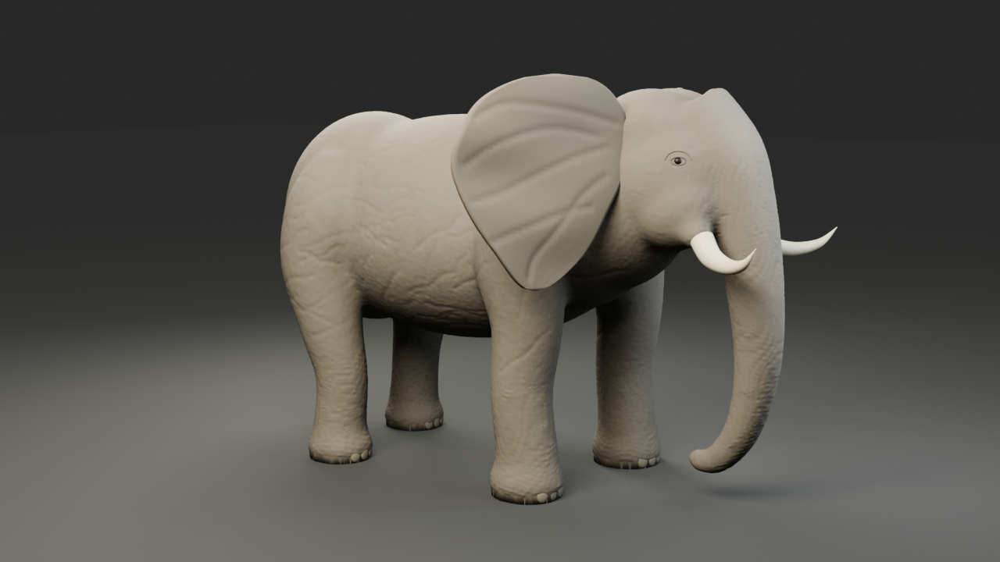

# Reviewed elephant r6 example

These are actual, unmodified PNGs rendered from the locally authored static elephant. The four Blender images and the separate V4 still belong to historical job `job-bd3b994f2785413c`. Their SHA-256 values and scoped critique are in [evidence.json](evidence.json).

[Front](preview_front.png) · [Side](preview_side.png) · [Back](preview_back.png) · [Native V4 LTC still](frame-045.png)

The original [owner-supplied reference](../../../../tools/local_3d_mcp/references/ep02_elephant_ref_r7.png) guided the geometry. No image-to-3D service or Trellis2 was used.

The body, head, legs and trunk form a connected sculpt. Ears, tusks, eyes, nails and tail have editable parts. Wrinkles are modeled geometry with plain PBR materials. This interpretation simplifies small wrinkles, facial detail and ear folds relative to the reference. V4 remains darker/browner, with a heavier shadow and a faint shadow-proxy edge; this example is not a final episode lighting approval.

The portable installer changes source fingerprints. Do not attach this old PASS to a newly built job. Follow [the portable installation guide](../../../27-LOCAL3D-PORTABLE-INSTALL.md) to generate and review your own files.

[Exact historical r6 source snapshot and recovery](SOURCE-SNAPSHOT.md) · [Fresh portable Windows gallery](../portable-windows/README.md)
