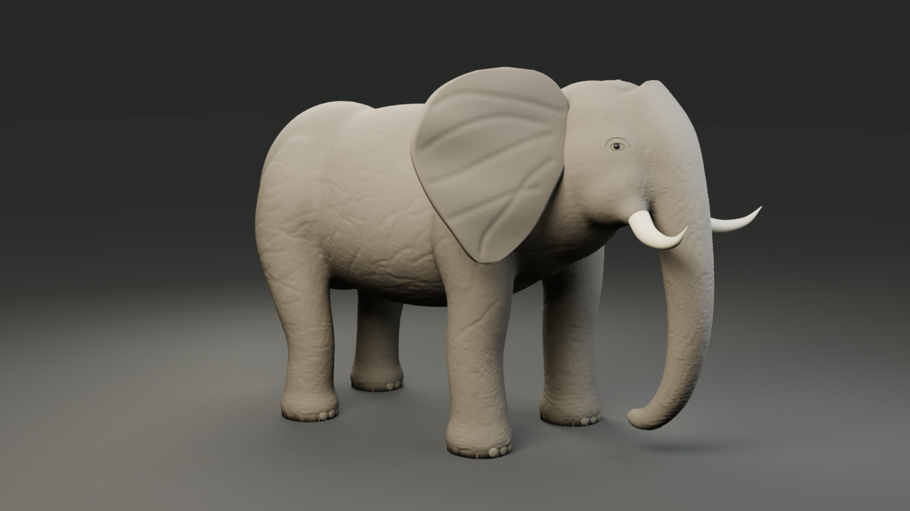
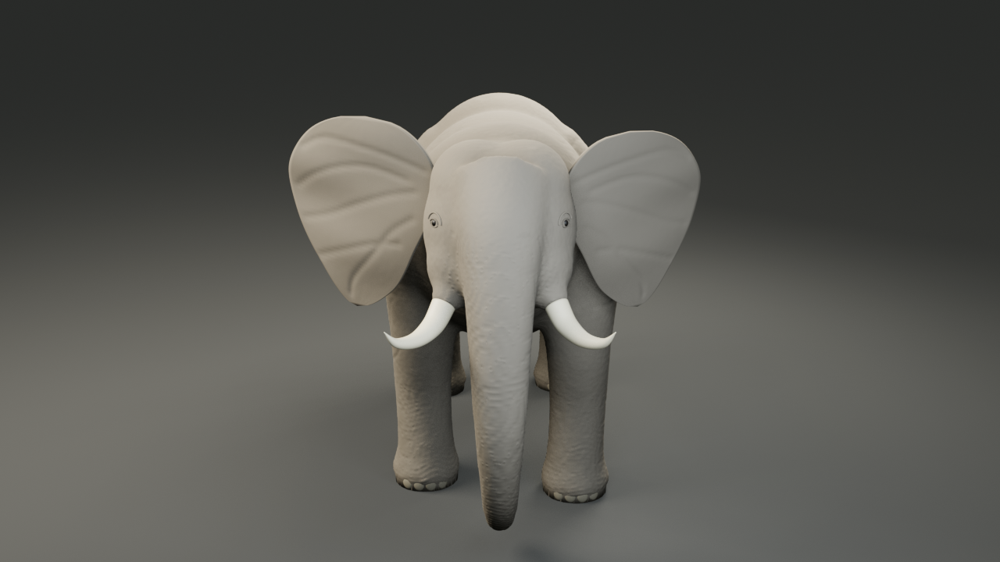
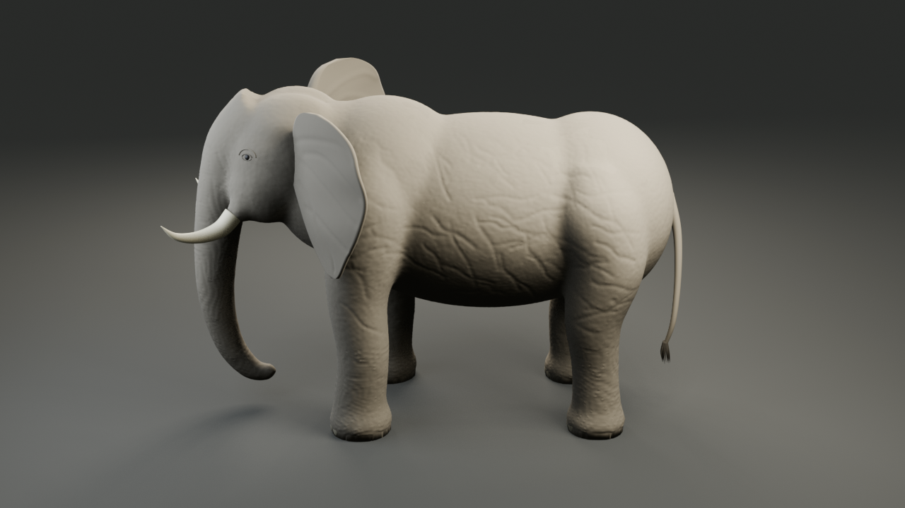
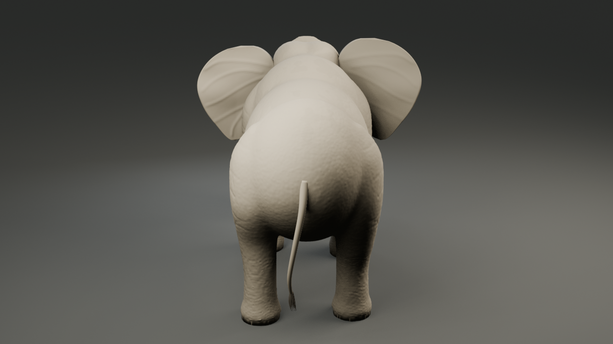
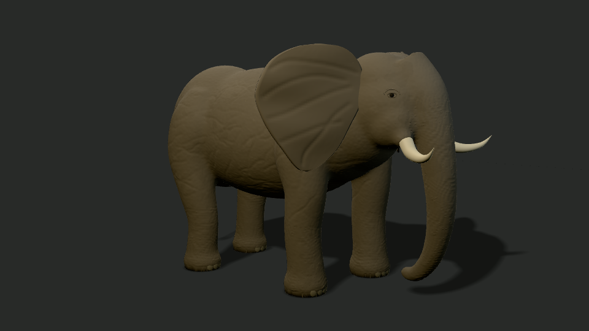

# Fresh portable Windows proof

These are the actual unmodified PNGs from the fresh isolated Windows installation, job `job-d51740b6569f4a17`, implementation `59038921d1a2e6de25dbb9c35bbef58e0778681b2685309c234daa659554e821`. They are separate from the [historical r6 gallery](../elephant-r6/README.md).

| Blender front | Blender side | Blender back |
|---|---|---|
|  |  |  |

## Standalone Remotion / Three LTC

The standalone image uses its own locked runtime and managed browser, without the private V4 channel tree. It is darker/browner than Blender and has a stronger approximate ground shadow. No final look parity is claimed.

The [portable proof summary](../portable-proof.json) binds image, GLB and source hashes, actual build timings, native resolution, control captures and the platform validation matrix. The [separate independent visual review](independent-review.json) records PASS for this static proof; the original pre-review manifest is preserved unchanged. Human artistic acceptance and production readiness remain separate.

For another computer, follow [the installation guide](../../../27-LOCAL3D-PORTABLE-INSTALL.md). New jobs require their own checks; these screenshots do not approve changed sources or artifacts.
