# Oriverse / Weave Research — 16 Reconstructed Workflow Diagrams

**PROVENANCE:** Reconstructed from the previously generated `Oriverse_Capability_Audit_SVG_Workflows.zip` DOT diagrams (graph titles, named steps, sequence/repair arrows). This is **not** a verbatim first-party Oriverse diagram or original Oriverse internal architecture. Oriverse-specific adapter mentions are *historical design proposals*, **not mandatory KHOSAN integration**. KHOSAN production remains native and independent.

## 01-end-to-end — Prompt-to-Playable Game

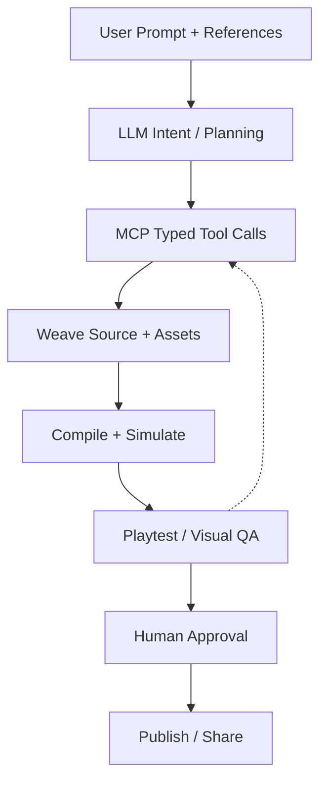

## 02-khosan-orchestrator — KHOSAN Studio Orchestration

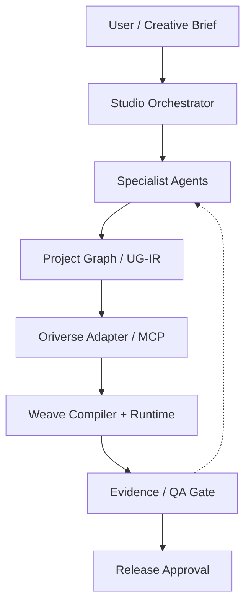

## 03-reference-to-3d — Reference-to-3D Reconstruction

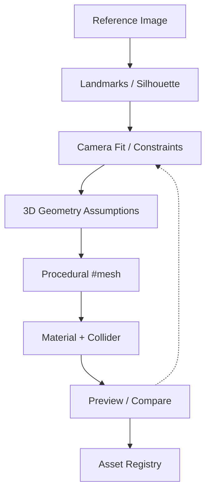

## 04-asset-provenance — Asset Provenance & Reuse

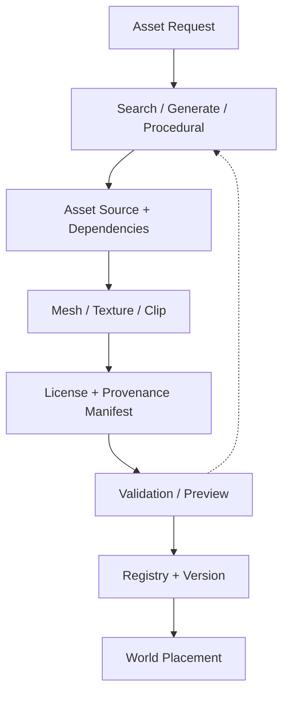

## 05-incremental-edit — Incremental Weave Editing

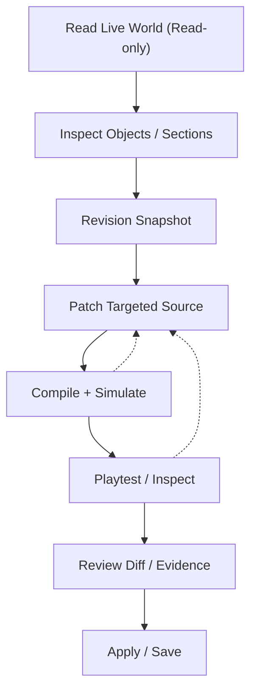

## 06-compiler-vm — Weave Compiler & Runtime

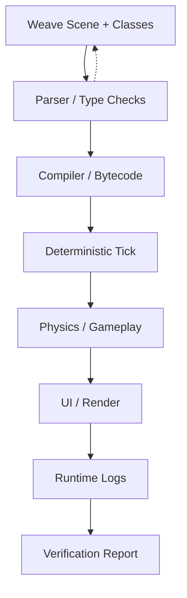

## 07-multiplayer — Multiplayer Verification

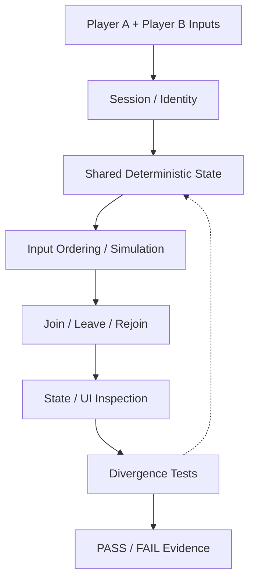

## 08-ui-qa — UI Interaction QA

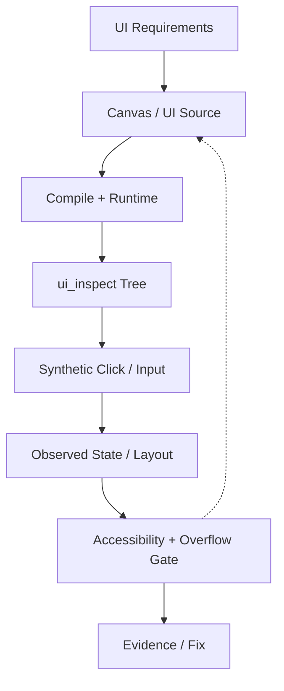

## 09-rendering-qa — Rendering Diagnostic QA

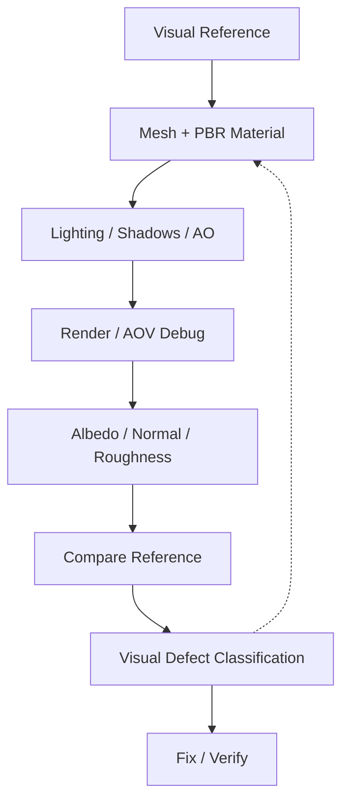

## 10-terrain-world — Terrain & World Generation

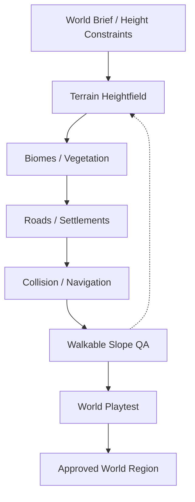

## 11-character-factory — Character Factory

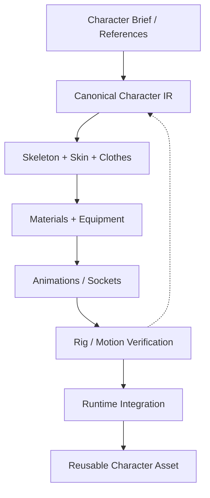

## 12-performance — Performance & Scaling

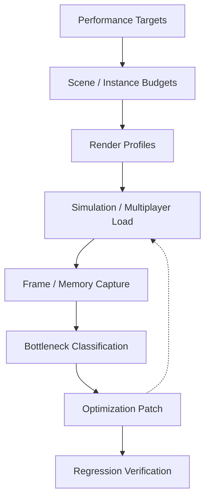

## 13-security-release — Security & Release Governance

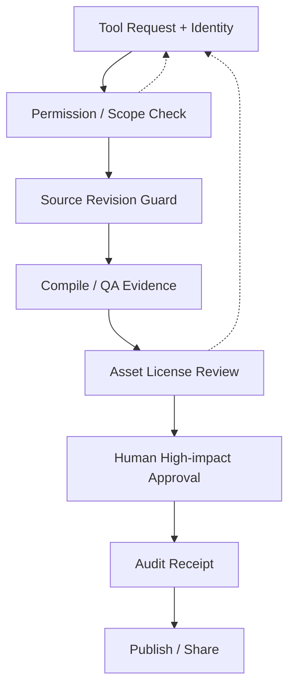

## 14-portability — Cross-engine Portability (Proposed)

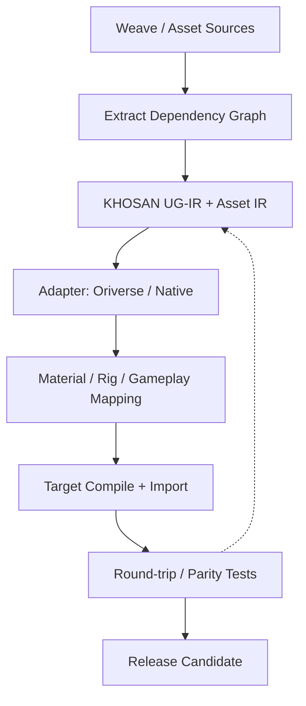

## 15-research-evidence — Technical Research Record (TRR)

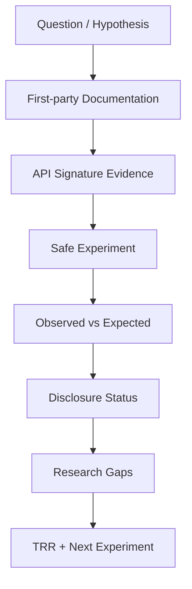

## 16-production-roadmap — KHOSAN Production Roadmap

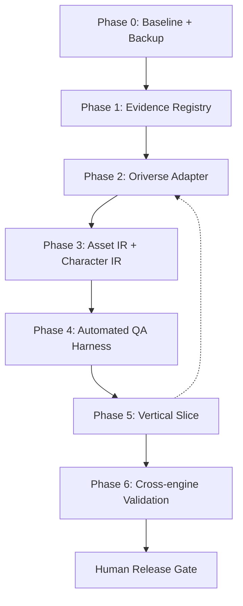

