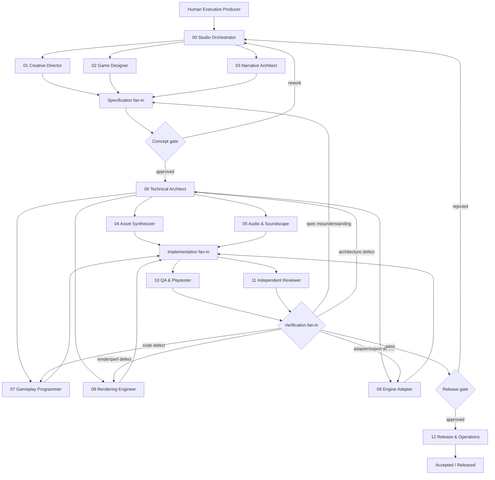

# KHOSAN Studio Execution Graph

## Routing rules

1. Orchestrator creates one bounded work item.
2. Activate only roles required by the work.
3. Material changes to product vision go through Concept Gate.
4. Technical Architect establishes contracts/budgets before expensive implementation.
5. Parallel production requires isolated paths or worktrees.
6. QA and Independent Reviewer are separate from makers.
7. Failure returns to the defect-origin layer.
8. External release/deploy waits for human approval.

## Stop conditions

Stop/escalate if:
- requirements conflict,
- acceptance criteria are not testable,
- required context is missing,
- protected/destructive operation is required,
- verification is flaky/non-reproducible,
- parallel agents require overlapping writes,
- work expands beyond the active task.
